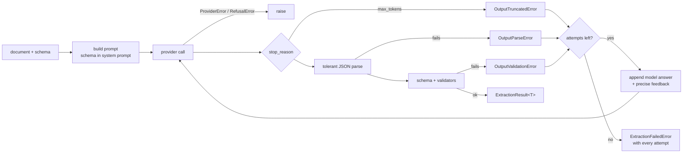

# llm-structured-extract

[](https://github.com/Dcrr1717/llm-structured-extract/actions/workflows/ci.yml)


**Typed, schema-enforced structured extraction over LLMs.** Describe the output as a
Pydantic model (or a JSON Schema), hand over a document, and get back a validated, typed
object. When the model's answer is invalid, the validation errors go back to the model
so it can repair its answer, up to a limit you set. Providers are pluggable, streaming
works with partial results, and the whole test suite runs offline.

```python
result = Extractor(AnthropicProvider()).extract(invoice_text, Invoice)
invoice: Invoice = result.value  # a real Invoice, not a dict
```

---

## The problem

LLMs are very good at *reading* messy documents such as invoices, papers, emails and
contracts. What they *produce*, though, is text, and production code needs data it can
trust. In practice the failures come in layers:

1. **Syntax.** The JSON comes wrapped in prose or markdown fences, has trailing commas,
   or is cut off by the output-token limit.
2. **Shape and types.** `"age": "thirty-six"`, `"sample_size": "212 adolescents"`, a date
   written as `3 March 2026`, a currency symbol where an ISO code was asked for.
3. **Semantics.** The JSON is valid and well-typed but still wrong: line items that don't
   add up to the subtotal, a confidence interval with `lower > upper`.

Constrained decoding (native "structured outputs") removes layer 1 and most of layer 2,
but nothing at the API level can check *your* business rules. This toolkit treats all
three layers the same way: **validate, explain the failure precisely, ask for a repair.**
That turns a brittle prompt into a feedback loop with a bounded cost.

## Features

- **Schema-first.** Use any type Pydantic v2 can validate (`BaseModel`, `list[Model]`,
  dataclasses, `TypedDict`) or a raw JSON Schema `dict`. Field and model validators run on
  every answer, so business rules become repairable errors.
- **Repair-and-retry.** Failed attempts are replayed to the model together with
  normalised, path-addressed issues (``- `line_items[1]`: amount 1530.00 does not equal…``).
  `max_retries` is configurable, and every attempt (raw text, error, usage) is kept in the
  result.
- **Tolerant parsing.** Handles fences, surrounding prose, trailing commas, comments,
  single quotes, Python literals and raw newlines in strings. A truncated object is
  reported as truncated; it is never "rescued" by returning one of its nested values.
- **Streaming.** `Extractor.stream()` / `astream()` yield partial JSON snapshots as tokens
  arrive (open strings and containers are closed, dangling keys dropped), a `RepairEvent`
  per failed attempt, then the final validated result.
- **Provider-agnostic.** A small `Provider` protocol plus a `BaseProvider` ABC. Ships with
  a deterministic, scriptable `MockProvider` and an `AnthropicProvider` built on the
  official SDK (default model `claude-opus-5-5`).
- **Typed errors.** `OutputError`s are repairable; `ProviderError` / `RefusalError` are not
  and propagate immediately; `ExtractionFailedError` carries the full attempt history.
- **Quality bar.** `mypy --strict` across source, tests and examples; `ruff`; GitHub
  Actions CI on Python 3.10–3.13; tests run with outbound network access blocked.

## Install

```bash
pip install "llm-structured-extract[anthropic] @ git+https://github.com/Dcrr1717/llm-structured-extract"
```

Extras: `anthropic` (the Claude provider) and `jsonschema` (validation against raw JSON
Schema documents). The core only depends on Pydantic.

## Quickstart (offline)

<!-- readme-test: exec -->
```python
from pydantic import BaseModel, Field

from llm_structured_extract import Extractor, MockProvider


class Person(BaseModel):
    name: str
    age: int = Field(ge=0, description="Age in years.")


# A scripted stand-in for an LLM: the first answer is wrong, the second is fixed.
provider = MockProvider(
    [
        '```json\n{"name": "Ada Lovelace", "age": "thirty-six"}\n```',
        {"name": "Ada Lovelace", "age": 36},
    ]
)

result = Extractor(provider, max_retries=2).extract("Ada Lovelace, 36, mathematician.", Person)

print(result.value)
print(f"attempts: {len(result.attempts)}")
print(f"first error: {result.attempts[0].error}")
```

<!-- readme-test: stdout -->
```text
name='Ada Lovelace' age=36
attempts: 2
first error: Output failed validation against `Person` schema (1 issue): age: Input should be a valid integer, unable to parse string as an integer
```

The fenced, prose-wrapped first answer parsed fine. It was the *type* that failed, and the
second attempt received this feedback:
``- `age`: Input should be a valid integer, unable to parse string as an integer (got: "thirty-six")``.

To run this against Claude, swap the provider: `Extractor(AnthropicProvider())`.

## Worked example: an invoice, repaired (MockProvider)

[`examples/invoice.py`](examples/invoice.py) defines an `Invoice` whose validators enforce
the invoice's arithmetic:

```python
class LineItem(BaseModel):
    description: str
    quantity: Quantity
    unit_price: Money
    amount: Money

    @model_validator(mode="after")
    def _amount_is_quantity_times_price(self) -> LineItem:
        expected = (self.quantity * self.unit_price).quantize(CENT, rounding=ROUND_HALF_UP)
        if self.amount != expected:
            raise ValueError(f"amount {self.amount:.2f} does not equal quantity x unit_price ...")
        return self


class Invoice(BaseModel):
    invoice_number: str
    issue_date: date
    currency: str = Field(pattern=r"^[A-Z]{3}$", description="ISO 4217 currency code, e.g. EUR.")
    line_items: list[LineItem] = Field(min_length=1)
    subtotal: Money
    tax: Money
    total: Money
    ...  # plus a model validator: line amounts sum to subtotal, subtotal + tax == total
```

Offline, a scripted `MockProvider` plays a model that makes three typical mistakes on
its first attempt: a non-ISO date, `€` instead of `EUR`, and a mis-copied line amount
(`1,530.00` for `3 × 450.00`). The output is deterministic:

```bash
python examples/invoice.py
```

<!-- readme-test: output-of invoice -->
```text
attempt 1: rejected - OutputValidationError
    - `issue_date`: Input should be a valid date or datetime, invalid character in year (got: "3 March 2026")
    - `currency`: String should match pattern '^[A-Z]{3}$' (got: "€")
    - `line_items[1]`: Value error, amount 1530.00 does not equal quantity x unit_price (3 x 450.00 = 1350.00)
attempt 2: valid

NW-2026-0142: Northwind Design Studio S.L. -> Lumen Analytics GmbH
  1 x Brand identity workshop (half day)       1,200.00
  3 x Logo design - three concepts             1,350.00
  6 x Website UI mock-ups (per page)           1,080.00
  total (EUR)                                   4,392.30
issued 2026-03-03, due 2026-04-02
attempts: 2, tokens: 3649
```

This is the repair turn the model received before attempt 2. It is appended to the
conversation after the model's own first answer:

<!-- readme-test: repair-prompt-of invoice -->
```text
Your previous response did not pass validation against the `Invoice` schema:

- `issue_date`: Input should be a valid date or datetime, invalid character in year (got: "3 March 2026")
- `currency`: String should match pattern '^[A-Z]{3}$' (got: "€")
- `line_items[1]`: Value error, amount 1530.00 does not equal quantity x unit_price (3 x 450.00 = 1350.00)

Return the complete, corrected JSON value and nothing else. Keep every value that was already correct and change only what is needed to fix the problems above, re-reading the document where necessary.
```

A second example, [`examples/research_abstract.py`](examples/research_abstract.py),
extracts screening metadata from a research abstract: study design from a controlled
vocabulary, sample size, findings with confidence intervals and p-values. It also shows
streaming:

```bash
python examples/research_abstract.py --stream
```

```python
for event in Extractor(provider).stream(SAMPLE_TEXT, ResearchAbstract):
    match event:
        case PartialEvent(data=data):  # best-effort JSON parsed so far
            render_progress(data)
        case RepairEvent(attempt=attempt):  # an attempt failed; feedback is on its way
            show_issues(attempt.error)
        case ResultEvent(result=result):  # validated ResearchAbstract
            save(result.value)
```

```text
  [attempt 1] receiving: title
  [attempt 1] receiving: authors
  ...
  [attempt 1] rejected, asking for a repair:
      - `study_design`: Input should be 'randomized_controlled_trial', 'cohort_study', ... (got: "randomized crossover trial")
      - `sample_size`: Input should be a valid integer, unable to parse string as an integer (got: "212 adolescents")
      - `key_findings[1].p_value`: Input should be a valid number, unable to parse string as a number (got: "<0.001")
  [attempt 2] receiving: title
  ...
```

## Live example with Claude

> [!WARNING]
> **Requires an Anthropic API key and makes a paid API call.** Nothing in the test
> suite or CI does this; tests use `MockProvider` or the real SDK over a mocked HTTP
> transport.

```bash
export ANTHROPIC_API_KEY="..."   # read from the environment; never hardcode or commit keys
python examples/invoice.py --live
python examples/research_abstract.py --live --stream
```

In code:

```python
from llm_structured_extract import AnthropicProvider, Extractor

provider = AnthropicProvider()  # claude-opus-5-5, native structured outputs, effort="medium"
result = Extractor(provider, max_retries=2).extract(SAMPLE_TEXT, Invoice)

print(result.value.total, result.value.currency)  # e.g. 4392.30 EUR
print(result.usage)  # tokens summed over all attempts
```

The model's output varies between runs, so this section shows no captured transcript.
With native structured outputs the syntax-level mistakes from the offline demo cannot
happen; semantic mistakes (a mis-read amount) still can, and those are what the repair
loop is for.

## Providers

### `AnthropicProvider`

Built on the official `anthropic` SDK. It only works when `ANTHROPIC_API_KEY` is set, an
`api_key=` is passed, or a configured client is injected (useful for custom base URLs,
proxies, profiles or workload identity). Constructing it otherwise raises
`ProviderNotConfiguredError`. The key never appears in `repr()`.

| `mode` | What constrains the output | Good for |
|---|---|---|
| `"json_schema"` *(default)* | Native structured outputs (`output_config.format`). The schema is rewritten into the subset the API accepts with `anthropic.transform_schema`; unsupported constraints (ranges, lengths) move into descriptions and are still enforced by validation. | Most extraction work |
| `"tool"` | One strict tool, `record_<Schema>`. When streaming, the tool input streams eagerly and is parsed incrementally. Repairs are sent as `is_error` tool results. | Tool-centric pipelines; live partial objects |
| `"prompt"` | Instructions only, no API-level constraint | Schemas the API cannot express (`Any`, recursion) and gateways without structured outputs |

Defaults and behaviour:

- **Model** `claude-opus-5-5`, **effort** `"medium"` (sent explicitly; pass `effort=None`
  for the API default). Adaptive thinking is left on, as the model requires.
- **Always streams** under the hood (`get_final_message()` for one-shot calls), which
  avoids HTTP timeouts on long outputs.
- **Append-only conversation.** During a repair, Claude's previous content blocks
  (thinking blocks included) are replayed verbatim, never edited. That keeps prompt-cache
  hits and satisfies Claude's preserved-thinking checks. The system prompt carries the
  schema, never changes between attempts, and is marked cacheable.
- **Refusals** (`stop_reason == "refusal"`) raise `RefusalError` with the category and are
  not retried. Server-side refusal fallback (`fallbacks="default"`, beta) is on by default;
  pass `refusal_fallback=False` for gateways that reject beta parameters.
- **Tool mode uses the model's raw JSON.** The SDK's tolerant parser can silently
  truncate malformed tool input (`{"a": 1 "b": 2}` becomes `{"a": 1}`). This provider
  parses the raw streamed JSON itself, so the defect is reported and repaired instead of
  silently dropping fields.
- API errors become `ProviderError` with `status_code` and a `retryable` hint (408, 409,
  429 and 5xx responses, plus connection errors). The SDK's own retries run first.

### `MockProvider`

Deterministic and scriptable. Each call consumes one script item: a `str` (returned
verbatim), a `dict`/`list`/Pydantic model (serialised to JSON), a `MockResponse` (custom
`stop_reason`/usage), an exception instance (raised), or a callable that computes the
answer from the `CompletionRequest`. It records every request, so tests can assert on
the exact repair prompts, and it streams in fixed-size chunks.

```python
MockProvider(
    [{"name": "Ada", "age": "x"}, MockResponse(text="{...", stop_reason="max_tokens")],
    responder=lambda request: {"name": "Ada", "age": 36},  # after the script runs out
)
```

### Bring your own

A provider is anything that satisfies the `Provider` protocol:

```python
class Provider(Protocol):
    @property
    def name(self) -> str: ...
    def complete(self, request: CompletionRequest) -> Completion: ...
    def stream(self, request: CompletionRequest) -> Iterator[StreamChunk]: ...
    async def acomplete(self, request: CompletionRequest) -> Completion: ...
    def astream(self, request: CompletionRequest) -> AsyncIterator[StreamChunk]: ...
```

Subclass `BaseProvider` and implement only `complete()` to get the other three
(non-incremental streaming, async via a worker thread). The contract: return raw text
without validating it, report truncation as `stop_reason="max_tokens"`, and raise
`ProviderError` / `RefusalError` for failed or declined calls.
[`examples/custom_provider.py`](examples/custom_provider.py) wraps any provider with a
response cache in about 20 lines.

## How it works



### Errors

| Exception | Meaning | Repaired? |
|---|---|---|
| `OutputParseError` | No JSON could be recovered (includes line and column) | yes |
| `OutputTruncatedError` | The output-token limit cut the answer off | yes |
| `OutputValidationError` | Parsed, but violates the schema; `.issues` lists every problem | yes |
| `MissingOutputError` | Empty answer, or no tool call in tool mode | yes |
| `ExtractionFailedError` | Every attempt failed; `.attempts`, `.last_error` | terminal |
| `RefusalError` | The model declined; `.category`, `.explanation` | no |
| `ProviderError` | The call failed; `.status_code`, `.retryable` | no |
| `ProviderNotConfiguredError` | Missing API key or optional dependency | no |
| `SchemaError` | The schema can't be built or used in the chosen mode | no |

All of them derive from `StructuredExtractError`.

## Development

```bash
python -m venv .venv && source .venv/bin/activate
pip install -e ".[dev]"
pytest                 # fully offline: no API key, no network, no cost
mypy                   # strict, over src/, tests/ and examples/
ruff check . && ruff format --check .
```

How the tests stay offline but still meaningful:

- Core behaviour (parsing, validation, the repair loop, streaming, async) runs against
  `MockProvider`.
- `AnthropicProvider` is tested against the **real SDK** with an `httpx2.MockTransport`
  that serves scripted Server-Sent Events. The SDK's own request serialisation and stream
  parsing are exercised, and tests assert on the exact JSON bodies and beta headers that
  would be sent.
- An autouse fixture blocks outbound sockets and DNS and removes `ANTHROPIC_API_KEY`, so
  a forgotten mock fails loudly instead of calling a paid API.
- The README's quickstart and example outputs are checked by `tests/test_readme.py`, so
  the documentation can't drift from the code.
- Live tests exist but are opt-in, and CI never sets these variables:
  `ANTHROPIC_API_KEY=... LSE_RUN_LIVE_TESTS=1 pytest -m live`.

### Releasing

Pushing a version tag publishes to PyPI through
[`release.yml`](.github/workflows/release.yml). It uses PyPI
[trusted publishing](https://docs.pypi.org/trusted-publishers/) (OIDC), so no PyPI API
token exists anywhere to leak.

1. Bump `__version__` in `src/llm_structured_extract/__init__.py`, the only place the
   version lives, and merge the change to `main`.
2. Tag that commit on `main` and push the tag:

   ```bash
   git tag v0.2.0 && git push origin v0.2.0
   ```

The workflow then:

- runs the full CI suite;
- refuses tags that are not on `main` or that don't match `__version__`;
- builds the sdist and wheel and checks them with `twine check --strict`;
- smoke-tests the wheel in a clean environment;
- publishes to PyPI, with PEP 740 attestations;
- creates a GitHub release with the files attached. Tags such as `v0.2.0rc1` are marked
  as pre-releases.

Every action is pinned to a commit SHA, and Dependabot keeps those pins up to date.

**One-time setup before the first release:**

- **PyPI:** add a *pending* trusted publisher under Account settings → Publishing, with
  project `llm-structured-extract`, owner `Dcrr1717`, repository `llm-structured-extract`,
  workflow `release.yml` and environment `pypi`.
- **GitHub:** create an environment named `pypi` under Settings → Environments. Optionally
  restrict it to `v*` tags and add a required reviewer, so each publish waits for a manual
  approval.

### Layout

```text
src/llm_structured_extract/
    extractor.py      # Extractor: the prompt → call → parse → validate → repair loop
    parsing.py        # tolerant + partial (streaming) JSON parser
    schema.py         # OutputSchema, PydanticSchema, JSONSchema
    prompts.py        # PromptBuilder: system, extraction and repair turns
    result.py         # ExtractionResult, Attempt, stream events
    errors.py         # typed error hierarchy, ValidationIssue
    types.py          # provider-neutral request/response types
    providers/
        base.py       # Provider protocol, BaseProvider ABC
        mock.py       # MockProvider
        anthropic.py  # AnthropicProvider
examples/             # invoice, research abstract (+ streaming), custom provider
tests/                # offline test suite (+ opt-in live tests)
.github/workflows/    # ci.yml (tests on 3.10-3.13, mypy, ruff), release.yml (PyPI on tags)
```

## License

[MIT](LICENSE) © 2026 César Daniel Reinoso
